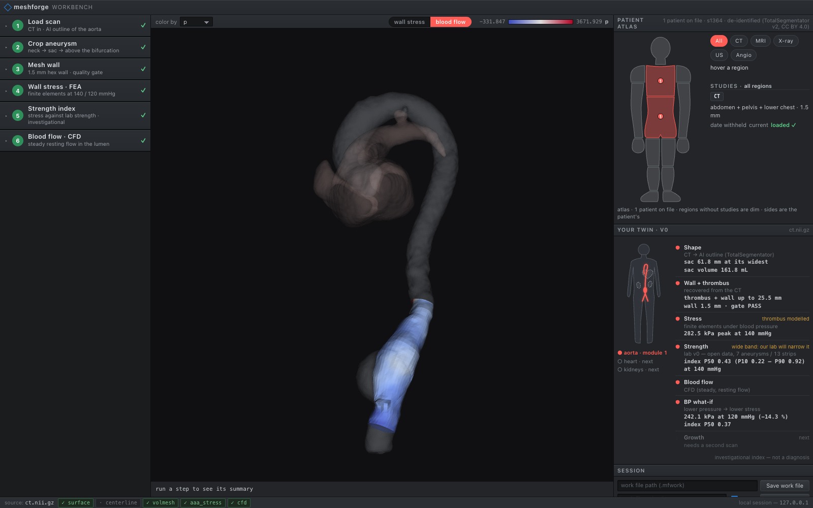

# meshforge — demo edition

An AI copilot takes one routine CT of an aortic aneurysm from scan to physics
on a laptop: AI outline of the aorta → crop to the aneurysm → hexahedral wall
mesh with a quality gate → wall stress by finite elements at two blood
pressures → an investigational strength index → blood flow by CFD. Research
software: not a medical device, not for diagnosis or treatment.



*The finished run on the demo scan: TotalSegmentator dataset, subject s1364
(Wasserthal et al., CC BY 4.0).*

## What the demo does

| | Step | What runs |
|---|---|---|
| 1 | Load scan | TotalSegmentator outlines the aorta on the CT; the outer aneurysm sac is recovered from the CT around it |
| 2 | Crop aneurysm | the aneurysm is cut out between two flat caps, from the neck to just above the bifurcation |
| 3 | Mesh wall | a 1.5 mm hexahedral wall, checked by a quality gate; a wall that fails the gate gives no stress |
| 4 | Wall stress · FEA | CalculiX solves the wall under blood pressure at 140 and 120 mmHg, with the thrombus modelled |
| 5 | Strength index | the peak wall stress divided by lab-measured wall strength: an investigational index, not a diagnosis |
| 6 | Blood flow · CFD | OpenFOAM solves a steady resting flow through the cropped blood lumen |

The copilot is a Claude model called through the Anthropic API. It plans the
steps, calls the tools and recovers when the wall fails its quality gate. It
computes no number: every number comes from a tool, and a guard checks every
number in its written summary against the tool outputs before the summary is
shown.

The steps show as six tabs in a local browser app, the Workbench, with the
3-D result in the middle and a patient atlas and a twin card on the right.
The full guide is [`docs/DEMO_GUIDE.md`](docs/DEMO_GUIDE.md).

## Install

```bash
git clone https://github.com/LeventS2005/meshforge.git
cd meshforge
conda env create -f environment.yml --solver=libmamba
conda activate meshforge
pip install -e ".[meshing,image,copilot,web]"
conda install -c conda-forge trame-vtk trame-vuetify
```

The last line is the 3-D view (the `viewport` extra). On macOS take it from
conda-forge, not pip; elsewhere `pip install -e ".[viewport]"` also works.
Python 3.10 or newer; the environment file uses 3.12.

The full run has been done on macOS with Apple silicon. Load scan runs TotalSegmentator on the Apple GPU (its `device` knob, `mps` by default). On another machine, set that knob to `cpu` in the Workbench and run the steps there: `meshforge copilot` and `scripts/demo_run.py` use the default.

## External tools

The demo calls three programs that are installed separately. meshforge looks
for each in this order:

| Tool | Used by | Found through |
|---|---|---|
| TotalSegmentator | Load scan | `MESHFORGE_TOTALSEG` (the executable), then `PATH`, then `~/miniconda3/envs/totalseg/bin/TotalSegmentator` |
| CalculiX (`ccx`) | Wall stress | `MESHFORGE_CCX`, then `PATH`, then `~/miniconda3/envs/ccxsolve/bin/ccx` |
| OpenFOAM | Blood flow | `MESHFORGE_OPENFOAM` (the launcher), then a sourced OpenFOAM on `PATH`, then an `openfoam` launcher on `PATH` |

TotalSegmentator goes in its own environment (it brings PyTorch, which
meshforge never imports):

```bash
conda create -n totalseg --solver=libmamba python=3.11
conda run -n totalseg pip install TotalSegmentator
conda create -n ccxsolve -c conda-forge calculix
brew install gerlero/openfoam/openfoam@2506    # OpenFOAM on macOS
```

If conda lives somewhere other than `~/miniconda3`, set `MESHFORGE_TOTALSEG` and `MESHFORGE_CCX` to the two executables.

## The demo scan

The demo runs on one public CT: subject s1364 of the TotalSegmentator dataset
(Wasserthal et al., CC BY 4.0, doi
[10.5281/zenodo.10047292](https://doi.org/10.5281/zenodo.10047292)). The file
is attached to the `v2.0.0` release of this repository as `ct.nii.gz`,
unchanged from the dataset:

```bash
curl -L -o ct.nii.gz https://github.com/LeventS2005/meshforge/releases/download/v2.0.0/ct.nii.gz
shasum -a 256 ct.nii.gz
# 7957f71d5a673486f0d23b403ece22233fdf1a5ac02a2ee4649fb99006f856dd
```

## Run it

**With the copilot.** Set your own API key in your own shell; every run calls
the Anthropic API and is billed to that key.

```bash
read -s ANTHROPIC_API_KEY && export ANTHROPIC_API_KEY
meshforge copilot "Assess this aneurysm at 140 and 120 mmHg" \
    --ct ct.nii.gz --server http://127.0.0.1:8765 --flow-live \
    --credit "TotalSegmentator dataset s1364 (Wasserthal et al.), CC BY 4.0"
```

This starts the Workbench on that port, opens its window, runs the six steps
while the tabs fill, and writes a report (`report.html`) built from the tool
outputs. About ten minutes on an Apple-silicon laptop.

**Without an API key.** The same six steps through the copilot's own tools,
with the same quality gate and the same recovery, and no language model:

```bash
python scripts/demo_run.py ct.nii.gz
```

**The page alone.** `meshforge web --port 8765`, then open
`http://127.0.0.1:8765/app/`. The server binds 127.0.0.1 only.

## What the numbers are and are not

On the demo scan the run gives: sac maximum diameter 61.8 mm; the first wall fails
the gate at 1.30 mm thick, the rebuilt wall passes at 1.50 mm (7,552
hexahedra, none inverted); peak wall stress 282.5 kPa at 140 mmHg and
242.1 kPa at 120 mmHg; strength index 0.43 (0.22 to 0.92) at 140 mmHg; a flow
case of 6,748 cells that converges.

They are the outputs of one model on one public scan, under stated
assumptions: a uniform 1.5 mm wall (a CT does not show the wall's thickness),
a linear solve on the imaged geometry, one steady resting flow, and wall
strength from 13 lab-tested strips of 7 aneurysms.

They are not a diagnosis, not a statement about this person's health, and not
clinically validated. The index is an investigational strength index. The
language model computes none of them.

## Tests

```bash
pip install -e ".[dev]"
python -m pytest -q tests/test_copilot.py     # one file per process is the reliable way
```

Tests that need TotalSegmentator, CalculiX or OpenFOAM skip when the program
is absent.

## Credits

- **Demo scan:** TotalSegmentator dataset, subject s1364. Wasserthal et al.,
  doi 10.5281/zenodo.10047292, CC BY 4.0.
- **Wall strength data:** Gomes VC et al., *Dataset on cadaveric human
  abdominal aorta aneurysm biomechanics (uniaxial) and histology*, Mendeley
  Data, version 3 (2020), doi 10.17632/x64srrc39p.3, CC BY 4.0. The packaged
  table is derived from it; see
  [`src/meshforge/data/STRENGTH_V0_SOURCES.md`](src/meshforge/data/STRENGTH_V0_SOURCES.md).
- **Tools:** [TotalSegmentator](https://github.com/wasserth/TotalSegmentator)
  (the aorta outline), [gmsh](https://gmsh.info) (tetrahedra for the thrombus
  and the lumen), [CalculiX](https://www.calculix.de) (wall stress),
  [OpenFOAM](https://www.openfoam.com) (blood flow) and
  [vtk.js](https://kitware.github.io/vtk-js/) (the 3-D view).

The general meshing toolkit of meshforge 1.x is not part of this edition. It
remains available at the tag
[`v1.0.0`](https://github.com/LeventS2005/meshforge/tree/v1.0.0).

## Licence

Apache-2.0 for the code ([`LICENSE`](LICENSE), [`NOTICE`](NOTICE)). The
packaged strength data are CC BY 4.0. To cite the software, see
[`CITATION.cff`](CITATION.cff).
